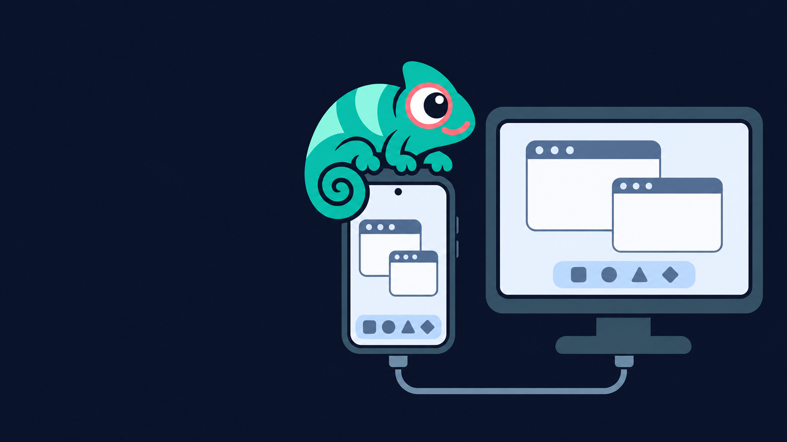

<p align="center">
  
</p>

# Lexona – Linux desktop on Android

**Lexona** (**L**inux **EX**perience **ON** **A**ndroid) runs a full XFCE desktop on an Android
phone or tablet, with no root and no separate Termux install. Use it on the phone's screen, on a
tablet, or on a monitor through Samsung DeX or USB-C display output. Unplug and your whole setup
comes with you.

- A native Linux userspace (Termux packages) for the desktop, plus an optional Debian container
  for glibc programs (Claude Code, Electron apps, `apt install` anything).
- An embedded X server (from Termux:X11) in its own Android process. No VNC.
- Hardware OpenGL where the GPU allows it (see [GPU support](#gpu-support)).
- USB drives, card readers and USB serial adapters without root.

> [!NOTE]
> Lexona was called **DroidDesk Fold** (`com.orailnoor.droiddesk`) until version 1.0.1-fold.108.
> Lexona 2.0 is a new app (`io.github.vyvrnc.lexona`) and installs next to the old one.
> The old README is kept in [docs/README-droiddesk-fork.md](docs/README-droiddesk-fork.md).

## Install

1. Download the APK from [Releases](../../releases), or track it with
   [Obtainium](https://github.com/ImranR98/Obtainium).
2. Open Lexona and start the setup. It downloads and installs the desktop and Debian: about
   10 minutes on a recent phone, about 16 minutes on a Galaxy A16. Keep the phone on Wi-Fi.
3. Tap **Launch desktop**.

Requirements: an ARM64 phone or tablet with Android 9 or newer and about 3 GB of free storage
(the desktop and Debian took 2.2 GB plus the Debian system on a Galaxy A16).

> [!IMPORTANT]
> **Child process limit.** Android 12 and newer stop the oldest programs of an app once it runs
> more than 32 of them. The desktop alone uses about 27. Lexona shows a warning on its home
> screen while the limit is on. To turn it off: **Settings → Developer options → Disable child
> process restrictions** (Android 14 and newer), or once from a computer:
>
> ```
> adb shell settings put global settings_enable_monitor_phantom_procs false
> adb shell device_config set_sync_disabled_for_tests persistent
> adb shell device_config put activity_manager max_phantom_processes 2147483647
> ```

## GPU support

What is tested, per GPU family. The app shows the same table under **GPU** on its home screen;
the details are in [docs/VERIFICATION.md](docs/VERIFICATION.md).

| GPU | Desktop and Linux apps | WebGL (Firefox) | Default |
|---|---|---|---|
| Adreno (Snapdragon) | OpenGL 4.6 on Zink/Turnip | WebGL 2, ~115 FPS | on |
| Xclipse (Exynos) | virgl over ANGLE/Vulkan | WebGL 2, ~57 FPS | opt-in |
| Mali (MediaTek, Exynos) | virgl over ANGLE/Vulkan; heavy 3D 2–8× faster than software | WebGL 2, ~34 FPS | opt-in |
| Others | software (llvmpipe) | works, slowly | – |

Opt-in: run `lexona-native-gpu on` in the terminal and restart the desktop.

**Test your device:** with the desktop running, run `lexona-gpu-report` in the terminal (or ask
Claude Code or Codex to run it). It writes one Markdown file; please attach it to an issue. See
[docs/gpu-test-kit.md](docs/gpu-test-kit.md).

## Commands

In the app's terminal or in XFCE's terminal. The older `droiddesk-*` names still work.

| Command | What it does |
|---|---|
| `start-debian` | Shell in the Debian container |
| `debian-run CMD…` | Run one Debian program from the native side |
| `claude-debian [args]` | Claude Code inside Debian (install it from the app's catalog) |
| `debian-setup` | Install or refresh the Debian integration; safe to repeat |
| `lexona-gpu on\|off\|status` | Hardware OpenGL for Debian programs |
| `gpu-run CMD…` | One Debian program with hardware OpenGL |
| `lexona-native-gpu on\|off\|status` | Hardware OpenGL for the native desktop on GPUs without Adreno |
| `lexona-gpu-report` | GPU test kit, one Markdown report |
| `lexona-open [--android] FILE\|URL` | Open with the Linux app, or with an Android app |
| `lexona-usb …` | Flash drives and card readers: `list`, `flash`, `read`, `format`, `check`, `ls`, `cp`, … |
| `lexona-usb-tray --window` | The USB window (also in the menu and in the dock) |
| `lexona-serial …` | USB serial adapters (FTDI, CP210x, CH34x, PL2303, CDC-ACM) as `/tmp/ttyUSB0` |
| `lexona-net` | Network status for Linux programs (VPN hints) |

## Storage

Lexona asks for storage access after the first start (Android 11 and newer show the **All files
access** page for builds that target them). With it, Linux programs see the
phone's storage under `~/storage/` (`shared`, `downloads`, `documents`, `pictures`, `dcim`,
`music`, `movies`) and Thunar has bookmarks for them. `/sdcard/Android/data` stays closed.

## Credits

Lexona is a fork of [DroidDesk](https://github.com/orailnoor/DroidDesk) by
[orailnoor](https://youtube.com/@orailnoor), through
[DroidDesk-Enhanced](https://github.com/techjarves/DroidDesk-Enhanced) by techjarves. It builds on
[Termux](https://termux.dev) packages and [Termux:X11](https://github.com/termux/termux-x11). The
USB disk layer follows [EtchDroid](https://github.com/EtchDroid/EtchDroid) and
[libaums](https://github.com/magnusja/libaums); USB serial uses
[usb-serial-for-android](https://github.com/mik3y/usb-serial-for-android).

## License and third-party software

Lexona is independent software licensed under [GNU GPL version 3 only](LICENSE). It is not
affiliated with or endorsed by Termux, Termux:X11, TUR, Canonical, Debian, Samsung, or other
upstream projects.

The Android application incorporates GPL-licensed Termux:X11 components and bundles other
third-party software under their respective licenses. See:

- [Notices and attribution](NOTICE.md)
- [Third-party software inventory](THIRD_PARTY_NOTICES.md)
- [Release compliance status](COMPLIANCE.md)

The current compliance checklist includes unresolved source provenance, reproducible-build,
custom-prefix bootstrap, and wallpaper-license work. Do not describe a binary release as fully
compliant until the blocking checklist items are complete.
